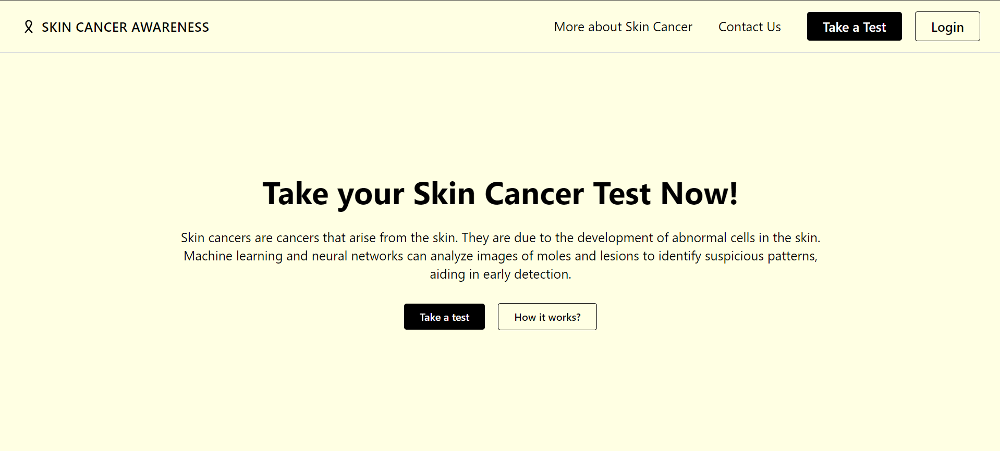

# Skin Disease Detection System with AI



A skin-lesion classifier for the seven diagnostic categories of the
[HAM10000](https://doi.org/10.7910/DVN/DBW86T) dataset, with a Flask web UI/API and a
[LangGraph](https://langchain-ai.github.io/langgraph/) triage pipeline.

> **Not a medical device.** This is a research/educational prototype. It cannot diagnose
> skin cancer. See a qualified dermatologist for any skin concern.

## What's in v2

| Area | Before | Now |
|---|---|---|
| Model | Decision Tree on flattened 64×64 pixels; a separate Keras CNN whose `.h5` was not in the repo | ImageNet-pretrained EfficientNet / MobileNetV3 / ResNet50, or any modern [timm](https://github.com/huggingface/pytorch-image-models) backbone (ConvNeXt-V2, EVA02, …) |
| Splitting | Random split (images of the same lesion leak between train and test) | Stratified split **grouped by `lesion_id`**, with a leakage assertion |
| Imbalance | None (nevus is ~67% of the data) | Class-weighted loss, augmentation, macro-F1 early stopping |
| Metrics | Accuracy | Accuracy, balanced accuracy, macro-F1, per-class report, melanoma recall, confusion matrix |
| Serving | Raw `.save(file.filename)` upload, missing templates | In-memory image handling, format/size limits, tests, `/health` |
| Agentic layer | – | LangGraph: quality check → classify → risk routing → explanation (Claude optional) |
| Clinical Assistant | – | Conversational intake, deterministic red-flag detection, risk fusion (`max()`), verifiable clinical report generation, and session management (see [`SAFETY.md`](SAFETY.md)) |

## Setup

```sh
python -m venv .venv && .venv\Scripts\activate
# RTX 50-series (Blackwell) needs CUDA 12.8 wheels; use plain `pip install torch torchvision` for CPU
pip install torch torchvision --index-url https://download.pytorch.org/whl/cu128
pip install -r requirements.txt
```

## Train

Download HAM10000 from [Harvard Dataverse](https://doi.org/10.7910/DVN/DBW86T) (or Kaggle
`kmader/skin-cancer-mnist-ham10000`): `HAM10000_images_part_1.zip`, `HAM10000_images_part_2.zip` and
`HAM10000_metadata.csv`. Unzip so the metadata CSV and the `.jpg` files sit somewhere under one folder
(`data/HAM10000/` is git-ignored).

```sh
python train.py --data-dir D:/datasets/HAM10000 --model efficientnet_b0 --epochs 15
# newer backbone:
python train.py --data-dir D:/datasets/HAM10000 --model timm/convnextv2_tiny.fcmae_ft_in22k_in1k
```

Outputs `<out-dir>/best.pt` (weights + class list + metrics) and `<out-dir>/metrics.json`
(`--out-dir`, default `models`). The test split is evaluated once, after training, on the best
validation checkpoint. Progress is saved each epoch to `last.pt`; add `--resume` to continue an
interrupted run.

### Independent evaluation

The ISIC 2018 Task 3 test set (1,511 images, also on the Dataverse page above) is never used in
training or model selection:

```sh
python eval_external.py --checkpoint models/best.pt --data-dir data/ISIC2018 --csv ISIC2018_Task3_Test_GroundTruth.csv
python eval_external.py --checkpoint models/best.pt --data-dir data/HAM10000 --holdout   # lesion-level test split
```

## Run the app

```sh
python -m webapp.app            # http://127.0.0.1:5000 (default: the 3-model ensemble, see DEFAULT_MODEL_PATH in webapp/app.py)
curl -F image=@lesion.jpg http://127.0.0.1:5000/api/predict
```

Several checkpoints can be ensembled (probabilities averaged) by comma-separating them:
`MODEL_PATH=models/a/best.pt,models/b/best.pt python -m webapp.app` (also
`python eval_external.py --checkpoint a.pt b.pt ...`).

### LLM features (optional, LangChain + LangGraph)

Set `ANTHROPIC_API_KEY` (model via `EXPLAIN_MODEL`, default `claude-sonnet-5-5`) to enable:

* **Structured explanation**: a LangChain chain with Pydantic-validated output (summary + next steps)
  inside the triage graph. On any LLM error it falls back to deterministic text.
* **"Ask a question about this result"**: a LangGraph pipeline `guard -> retrieve -> answer`
  (`POST /api/chat`), grounded only in the project's own lesion/precaution text, with input
  limits, a whitelist on client-supplied class codes, and a per-client rate limit.

Without a key both are off and nothing is sent anywhere. The image is never sent to an LLM, only
class names and probabilities, and the prompts forbid diagnosing or reassuring.

## Results

Trained on HAM10000 (lesion-level 80/10/10 split) plus about 14,900 ISIC 2019 images added to the
training split only. Two evaluation sets are never used for training or model selection:

* **ISIC 2018 Task 3 test set**: 1,511 independent images (171 melanomas, 908 nevi).
* **Held-out HAM10000 test split**: 1,002 images whose lesions are not in training.

Cells show accuracy / macro-F1 / balanced accuracy (ISIC 2018) and accuracy / macro-F1 (held-out).
The first two rows are single models without test-time augmentation; the rows below them use the
shipped inference mode (8-view TTA). Every number below is regenerated by `scripts/make_model_card.py`
and shown in the app on the **Technical details** page.

| Model | ISIC 2018 | Held-out HAM10000 |
|---|---|---|
| EfficientNet-B0, HAM10000 only (baseline) | 69.1% / 0.601 / 0.739 | 69.3% / 0.563 |
| ConvNeXt-V2 tiny, HAM10000 only | 75.7% / 0.661 / 0.732 | 77.1% / 0.643 |
| ConvNeXt-V2 tiny, + ISIC 2019, softer class weights | 84.7% / 0.766 / 0.748 | 85.0% / 0.722 |
| EfficientNetV2-S, same data | 83.3% / 0.732 / 0.721 | 83.0% / 0.739 |
| MaxViT-tiny, same data | 85.9% / 0.786 / 0.782 | 85.7% / 0.743 |
| **Ensemble of the three (shipped default)** | 87.0% / 0.812 / 0.800 | 87.5% / 0.777 |

Notes on reading this table:

* The "+ ISIC 2019" rows change two things at once (more data **and** `--weight-power 0.5`), so the
  gain cannot be attributed to either alone.
* The ensemble was the natural combination, but combinations were compared on the same ISIC 2018
  set reported above, so treat its margin over the best single model as slightly optimistic.
* 8-view TTA leaves the ensemble's accuracy and macro-F1 within noise (ISIC 2018: 87.0% / 0.812 with TTA
  vs 87.2% / 0.806 without). Its visible effect is on the risk flag's sensitivity (about 86% to 89.5%).
* **Melanoma is the weak spot.** Top-1 melanoma recall is only about 0.65 (ISIC 2018). The app's
  risk flag (top class malignant, or at least 20% combined raw probability on melanoma / basal cell /
  actinic keratosis) flags **89.5%** of melanomas and **14.0%** of nevi,
  so about 10% of melanomas are not flagged, and the UI says so. The threshold was fixed before
  looking at this data and is defined on the *raw* probabilities; do not retune it on the test sets.
* Per-class (ensemble, ISIC 2018) precision / recall: akiec 0.70 / 0.74, bcc 0.84 / 0.85, bkl 0.86 / 0.74, df 0.83 / 0.77, mel 0.71 / 0.65, nv 0.91 / 0.95, vasc 0.94 / 0.89.

### Confidence and calibration

The models trained with label smoothing, class weights and probability averaging were **under-confident**:
on ISIC 2018 their average stated confidence was 64.5% while they were right 87.0%
of the time (calibration error 0.229). The app therefore shows temperature-scaled probabilities
(`T = 0.48`, fitted on the HAM10000 **validation** split only, `scripts/fit_calibration.py`):
average stated confidence 89.6%, calibration error 0.032 on the independent set.
Calibration changes the displayed percentage only, never the predicted class or the risk flag.
It is applied only when the checkpoints match the ones it was fitted for.

| Percentage shown (ISIC 2018) | Images | Actually correct |
|---|---|---|
| 0% to 50% | 44 | 25% |
| 50% to 70% | 127 | 49% |
| 70% to 90% | 248 | 75% |
| 90% to 97% | 558 | 95% |
| 97% to 100% | 534 | 98% |

**A high percentage is not safety**: of the 765 images called a nevus with 90% or more shown confidence,
13 were melanomas (1.7%), i.e. 7.6% of all melanomas in the test set.

### What did not help

Image processing applied at test time to models trained without it (no retraining), ensemble on the
HAM10000 validation split: hair removal (black-hat + inpainting) cut accuracy from 89.4% to 75.0%,
Shades-of-Gray colour constancy to 87.0%, CLAHE to 84.0%. These steps would only be worth trying inside
training, which is untested here.

### Grad-CAM

The results page can show a Grad-CAM heatmap. It is drawn from the **first** checkpoint in
`MODEL_PATH` only: on ISIC 2018, EfficientNetV2-S's Grad-CAM put 82% of its mass in the outer border
ring (a feature-map edge artefact: blanking the border costs only about 3 accuracy points), whereas
ConvNeXt-V2's stays centred on the lesion (23% in a ring covering 50% of the area). Blanking the lesion
area drops accuracy to about 65%, close to the 59.6% of always answering "nevus", so the models mostly
read the lesion, but they keep a small background signal (5 to 7 points above that baseline).

## Triage graph

```
check_quality ──► classify ──► assess_risk ──► explain
      └─(blank / tiny image)──► END
```

`assess_risk` marks a case **high** if the top class (or ≥20% combined probability) is
melanoma, basal cell carcinoma or actinic keratosis, **elevated** if the top probability is under 50%,
otherwise **low**.

### Reproducing the shipped models

```sh
# data: HAM10000 -> data/HAM10000, ISIC 2018 test -> data/ISIC2018, ISIC 2019 train -> data/ISIC2019
python scripts/fetch_parallel.py <url> <out.zip>          # resumable multi-connection download
python scripts/run_combined.py                            # ConvNeXt-V2 on HAM10000 + ISIC 2019
python scripts/run_queue.py                               # EfficientNetV2-S, then MaxViT-tiny
python scripts/fit_calibration.py <ckpts...>                # temperature, validation split only
python scripts/make_model_card.py <ckpts...>                # webapp/model_card.json (Technical details page)
python scripts/risk_flag_eval.py <ckpts...> --data-dir data/ISIC2018 --csv ISIC2018_Task3_Test_GroundTruth.csv
```

The trained weights (about 320 MB; `models/` is git-ignored, and the ConvNeXt file alone exceeds
GitHub's 100 MB limit) are not in the repository: publish them with Git LFS or a GitHub Release.

## Tests

```sh
python -m pytest -q
```

## Repo layout

```
skinlesion/   config, data, model, evaluate, predict (ensemble), triage (LangGraph), llm (LangChain)
scripts/      parallel downloader, run_combined.py / run_queue.py (train on HAM10000 + ISIC 2019)
webapp/       Flask app + template
train.py      training CLI (resumable)
eval_external.py   evaluate a checkpoint on the held-out split or an independent set
tests/        unit + API tests
legacy/       original Decision Tree script and Flask backend (kept for reference)
DT/, screenshots/, Skin Disease Detection Report.pdf   original project material
```

## Data and attribution

HAM10000: Tschandl, Rosendahl & Kittler, *Sci Data* 5, 180161 (2018); ISIC 2018 Task 3 test set,
both CC BY-NC 4.0 (non-commercial). The four sample images under `webapp/static/samples/` come from the
ISIC 2018 Task 3 test set and are used under that licence.

## Roadmap

Planned work (conversational symptom intake, higher-resolution retraining, phone-photo and skin-tone
evaluation, published weights, CI) and the safety principles any future version must keep are in
[ROADMAP.md](ROADMAP.md).

## Limitations

HAM10000 is dermoscopic imagery from two sites and skews toward lighter skin tones; the model
will not generalise to phone photos or darker skin without additional data. Probabilities are not
calibrated clinical risk.
